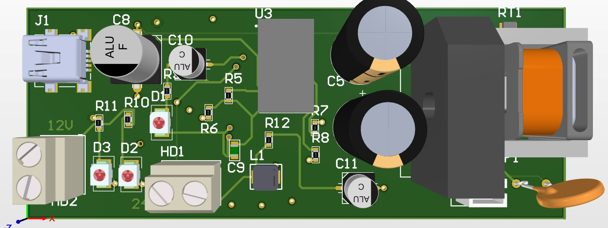
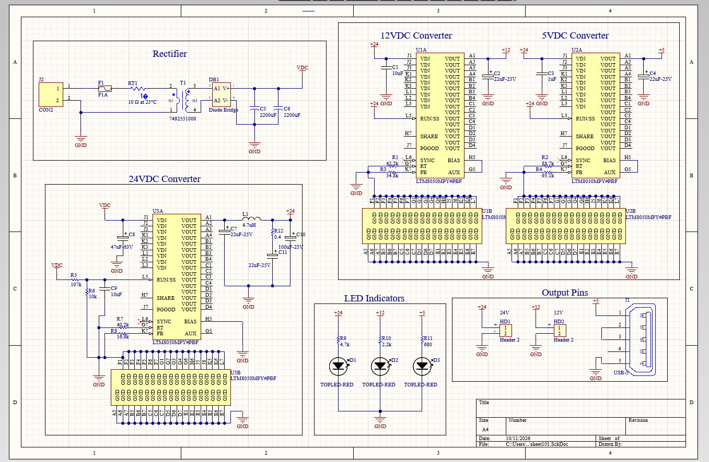
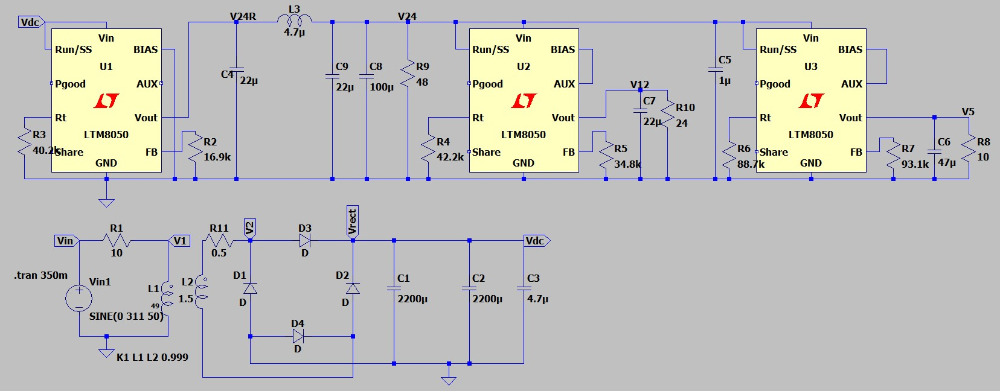
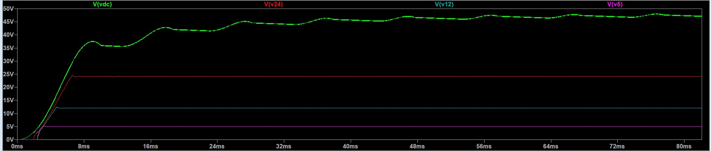
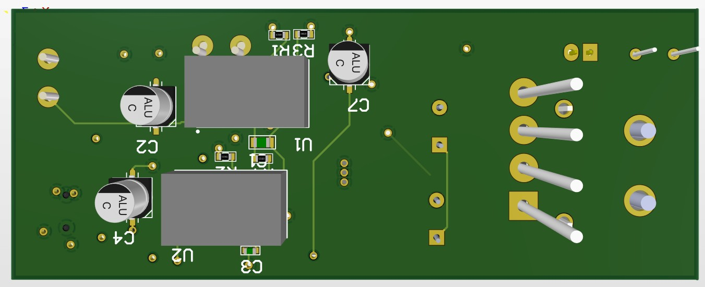

# 220 VAC to 24 V / 12 V / 5 V DC Power Supply

A multi-rail DC power supply that runs from 220 VAC mains: a transformer and bridge rectifier feed three LTM8050 step-down µModule regulators, with an LC filter on the 24 V rail. The design is simulated in LTspice, drawn in Altium Designer and laid out as a PCB.

**Status:** Simulation complete. Schematic and PCB layout done in Altium Designer. Not yet fabricated or tested on hardware.



## Overview

| Item | Value |
|---|---|
| Input | 220 VAC, 50 Hz mains |
| Outputs | 24 V, 12 V, 5 V DC |
| Rated power | 30 W total |
| Regulators | 3x LTM8050 (58 V input µModule buck regulator) |
| Output connectors | 24 V and 12 V screw terminals, 5 V USB connector |
| Indicators | One LED per rail |
| Simulation | LTspice |
| Schematic / PCB | Altium Designer |

## Architecture

```
220 VAC -> fuse -> NTC inrush limiter -> transformer -> bridge rectifier -> 2x 2200 uF -> DC bus (~47 V in simulation)
DC bus -> U3 (LTM8050) -> LC filter -> 24 V rail
24 V   -> U1 (LTM8050) -> 12 V rail
24 V   -> U2 (LTM8050) -> 5 V rail
```

The 12 V and 5 V rails are fed from the filtered 24 V rail, not directly from the rectified bus, so the 24 V converter carries the full load.

## Schematic



- **Rectifier:** fuse, 10 ohm NTC thermistor (inrush limiting), Würth 7492551000 transformer, diode bridge, 2x 2200 uF bulk capacitors.
- **24 V converter:** LTM8050 with a 107k / 10k divider and 10 uF capacitor on RUN/SS for input undervoltage lockout and soft start.
- **24 V output filter:** 4.7 uH inductor with 22 uF and 100 uF capacitors, plus a 22 uF capacitor in series with a 0.4 ohm resistor for damping. This removes high-frequency switching noise and smooths the 24 V rail.
- **12 V and 5 V converters:** LTM8050 stages fed from 24 V, each with its own input and output capacitors.
- **Indicators and outputs:** a 24 V / 12 V / 5 V LED set (each resistor sized for roughly 4.5 mA) and the output connectors.

### Feedback and frequency-setting resistors

| Rail | Rt | RFB (to FB pin) |
|---|---|---|
| 24 V (U3) | 40.2 k | 16.9 k |
| 12 V (U1) | 42.2 k | 34.8 k |
| 5 V (U2) | 88.7 k | 93.1 k |

## Simulation (LTspice)



The model uses a 311 V peak, 50 Hz source (220 VAC RMS), a 10 ohm source resistance, a coupled-inductor transformer (L1 = 49, L2 = 1.5, K = 0.999), a diode bridge, 2x 2200 uF bulk capacitors, and the three LTM8050 stages with the 24 V LC filter. Simulated loads:

| Rail | Load | Power |
|---|---|---|
| 24 V | 48 ohm | 12 W |
| 12 V | 24 ohm | 6 W |
| 5 V | 10 ohm | 2.5 W |

Total simulated load: 20.5 W.

### Start-up result



- The DC bus charges up to about 47 V within roughly 80 ms.
- All three rails come up cleanly in the first few milliseconds. The 24 V rail settles at 24 V, the 12 V rail at 12 V and the 5 V rail at 5 V, with no sustained oscillation.
- The 24 V rail was noisy before the LC filter was added. With the filter it is smooth, and the 12 V and 5 V rails derived from it are clean.
- The bus stays below the LTM8050's 58 V input limit.

Still to add: ripple measurements (in mV, zoomed in on the settled waveform), a load-step response and an efficiency estimate.

## PCB



- The 24 V converter, rectifier, bulk capacitors, transformer, connectors and LEDs are on the top side.
- The 12 V and 5 V converters are on the second side of the board.
- Altium Designer 3D views are in `docs/`.

## Repository structure

```
.
├── README.md
├── simulation/   # LTspice .asc file
├── hardware/     # Altium project, Gerbers
├── docs/         # images used in this README
└── bom/          # bill of materials
```

## Next steps

1. Fabricate the PCB and assemble a prototype.
2. Measure output voltage, ripple, efficiency and temperature rise at 30 W.
3. Compare the measured results with the simulation and add them here.

## Tools

LTspice, Altium Designer, LTM8050 µModule regulators.

## Author

Prince Sackey, Electrical and Electronics Engineering, Istanbul University-Cerrahpaşa.
